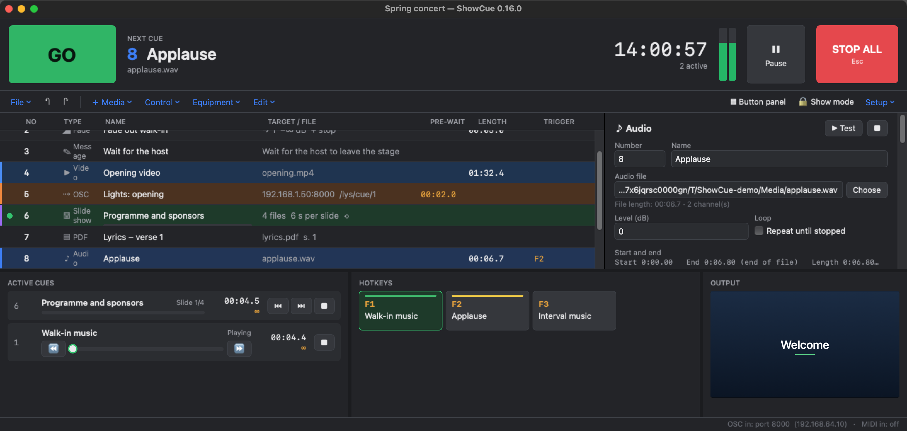
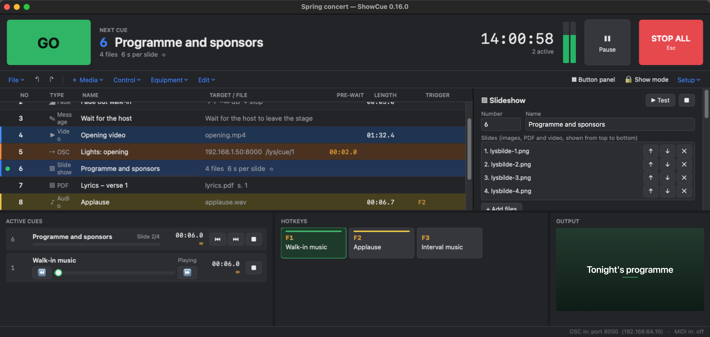
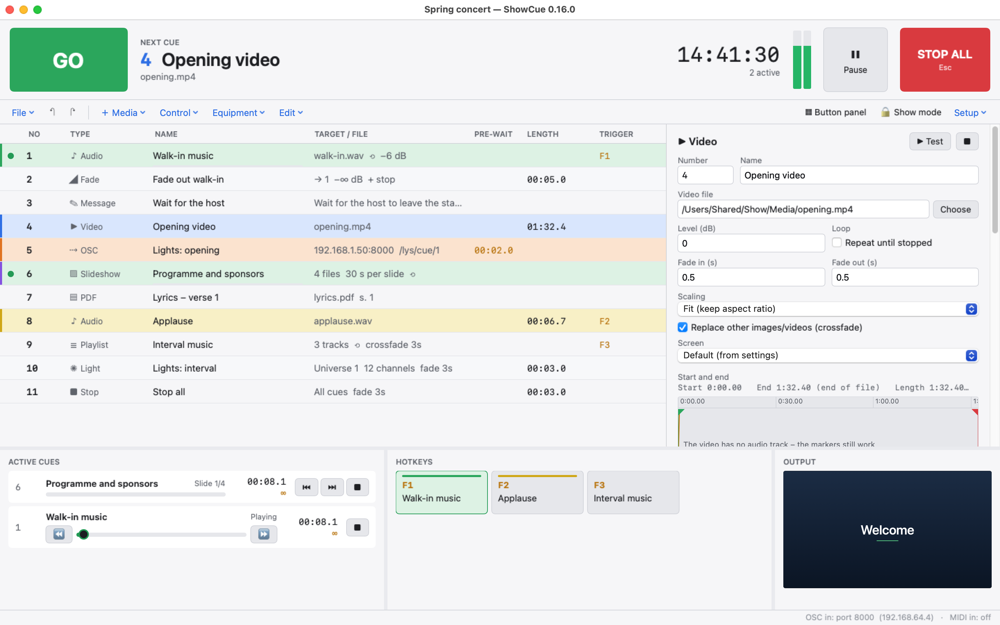
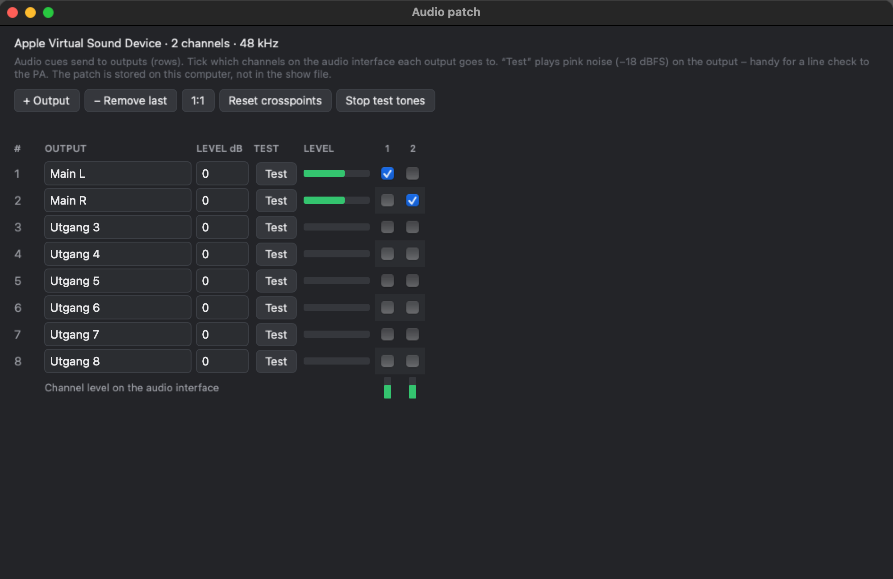
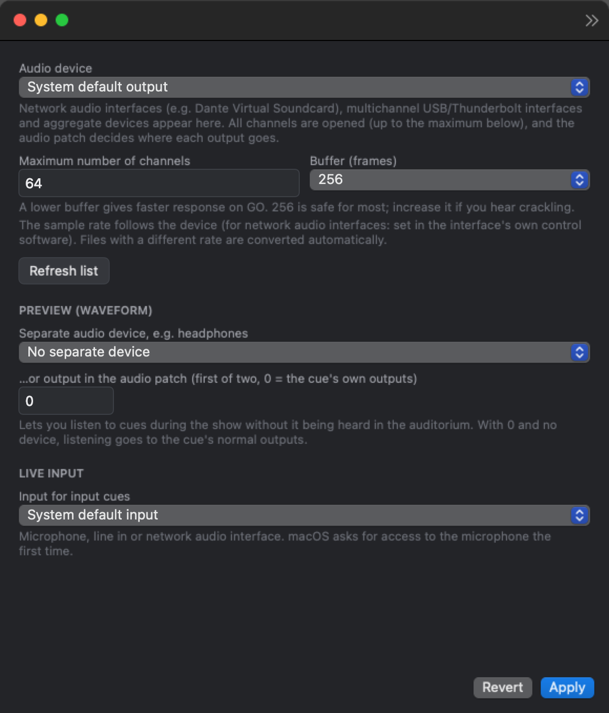

# ShowCue for Mac

*[Norsk](README.md)*

A native Mac app written in Swift. It uses Apple's own frameworks (CoreAudio, AVFoundation, PDFKit and CoreMIDI) and needs no add-ons.
It has the same features as the Windows version, and **the show files (`.showcue`) can be opened on both platforms**.

Requires macOS 13 (Ventura) or newer. Runs on both Apple Silicon and Intel.

## Screenshots



| Slideshow selected | Light theme |
|---|---|
|  |  |

## Building and starting

**Easiest, with Xcode** (free from the App Store):
1. Double-click `Package.swift`. Xcode opens the project.
2. Choose “My Mac” at the top and press ▶ (⌘R).

**Making ShowCue.app** (Xcode or Command Line Tools, `xcode-select --install`):
```
cd Mac
./build-app.sh
open build/ShowCue.app
```
Drag `build/ShowCue.app` to the Applications folder.

`./make-dmg.sh` also creates `build/ShowCue-Mac.dmg` (a disk image with the app and a shortcut to Applications).

**Ready-built app from GitHub:** GitHub Actions builds the app, runs the tests and puts `ShowCue-Mac.dmg` and `ShowCue-Mac.zip`
under *Releases*. Open the dmg file and drag ShowCue to *Applications*.

The app is not notarised by Apple yet, so macOS stops it the first time. From macOS 15, “right-click → Open”
no longer works: open *System Settings → Privacy & Security*, scroll down and press **Open Anyway**.
Alternatively in Terminal: `xattr -dr com.apple.quarantine /Applications/ShowCue.app`.

The first time you start the app, macOS asks for access to the **local network**. Say yes, otherwise OSC does not work.

## Multichannel audio interfaces and network audio

DVS on a Mac is an ordinary CoreAudio device.
Example with Dante Virtual Soundcard:

1. Start Dante Virtual Soundcard. Choose the number of channels in DVS and the sample rate in Dante Controller.
2. ShowCue → **Settings → Audio**: choose “Dante Virtual Soundcard”. All channels are opened, up to 64 by default.
3. **Audio patch** (*Setup → Audio patch*): tick which Dante channels each output goes to. You can line-check with **Test** (pink noise at −18 dBFS).
   Route the channels onwards in Dante Controller.

The same applies to other multichannel audio interfaces and aggregate devices created in Audio MIDI Setup.
The sample rate follows the device, and files with a different rate are converted automatically in high quality.

| Audio patch | Settings |
|---|---|
|  |  |

## Differences from the Windows version

| | Mac | Windows |
|---|---|---|
| Audio driver | CoreAudio (all devices, including network audio interfaces) | WASAPI or ASIO |
| Audio formats | WAV, AIFF, MP3, M4A/AAC, ALAC, FLAC, CAF | WAV, AIFF, MP3, M4A/AAC, FLAC, WMA |
| Video formats | MP4, MOV, M4V (H.264, HEVC, ProRes) | MP4, MOV, WMV, AVI, MKV (H.264 safest) |
| Settings | `~/Library/Application Support/ShowCue/` | `%AppData%\ShowCue\` |
| Zoom in the waveform | Pinch on the trackpad or −/+ | Mouse wheel |
| Hotkeys | The F keys require `fn`, unless “Use F1, F2, etc. keys as standard function keys” is turned on | |

Everything else is the same: language (Norwegian/English), cue types, start/end editing with waveform and preview, routing matrix, audio patch, video audio through the patch, OSC/MIDI in and out, MSC, status out over OSC, themes and cue colours.
See the README in the Windows folder for a full description of OSC commands and status variables.

**Show files between Mac and Windows:** the paths to the media files differ on the two platforms. ShowCue therefore looks for media files
next to the show file and in a subfolder `Media`, so put the show file and the media in the same folder when moving between computers.
Shows saved on a Mac require Windows version 0.4 or newer.

## Keyboard

| Key | Function |
|---|---|
| Space | GO |
| Esc | Stop all (twice = immediately) |
| ↑ / ↓ | Move the GO playhead |
| ⌘1 … ⌘8 | Add audio, video, image, PDF, fade, stop, OSC, MIDI |
| ⌘9, ⌘0 | Add playlist, go to cue |
| ⌘P | Pause / resume all |
| ⇧⌘M, ⇧⌘N | Add message, network cue |
| ⌘K | Button panel |
| ⌘+ / ⌘− | Zoom in / out (normal size in the *Setup* menu) |
| ⌥⌘T, ⇧⌘L, ⇧⌘I, ⇧⌘W | Add timecode, light, input, web page cue |
| ⇧⌘B | Add slideshow |
| ⌘D, ⌘⌫, ⌘↑/⌘↓ | Duplicate, delete, move |
| ⌘S, ⇧⌘S, ⌘O, ⌘N | Save, save as, open, new |
| ⌘Z, ⇧⌘Z | Undo, redo |
| ⌘L | Show mode (lock editing) on/off |
| ⇧⌘T | Switch theme |
| ⇧⌘U | Show/hide the output window |
| ⌘, | Settings |

Audio and video cues that are playing can be scrubbed under *Active cues* (drag the bar, or ⏪ / ⏩ for 5 seconds).
*＋ Media* creates an empty cue; choose the file with *Browse*, or drop a file on the cue.

Click selects, ⌘-click selects several and ⇧-click selects a range. Double-click tests the cue. Right-click opens a menu with colour, enable/disable and duplicate.
You can drag files from the Finder straight into the list.

Show mode, undo, autosave (`~/Library/Application Support/ShowCue/Autolagring`), backups
(`…/ShowCue/Sikkerhetskopier`) and preview to headphones work as on Windows – see *Safe during the show*
in the README in the Windows folder. The same applies to pause, playlists, go to, release loop, run from here and fade curves
(*Pause, playlists and loop*), and the button panel, network and message cues, loudness normalisation and find/collect
media files (the *File*, *Edit* and *Tools* menus in the menu bar) – see *Button panel, network, message and loudness* and *Media files: find and collect*. Timecode, lighting over Art-Net and
live input are described under *Timecode, lighting and live input* (on a Mac the input is chosen among the CoreAudio devices,
and macOS asks for access to the microphone the first time).

## Structure

```
Sources/ShowCue/
  Core/    Models (same JSON as Windows), OSC, status out, remote control, language (Loc),
           MIDI parsing, mixer (PatchMixer, Voice, ring buffer). Tested automatically.
  Audio/   CoreAudio output (AUHAL), devices, decoding on a separate thread (AVAudioFile / AVAssetReader)
  Engine/  Cue engine, active cues, video/image/PDF output, CoreMIDI, app model
  UI/      SwiftUI: main window, cue list, inspector, routing matrix, audio patch, settings, themes
Tests/     XCTest (run with “swift test” or ⌘U in Xcode)
```

The audio thread only reads already decoded audio from ring buffers. A separate thread decodes, and the main thread controls the cues.
The audio therefore never waits for the disk or the user interface.
