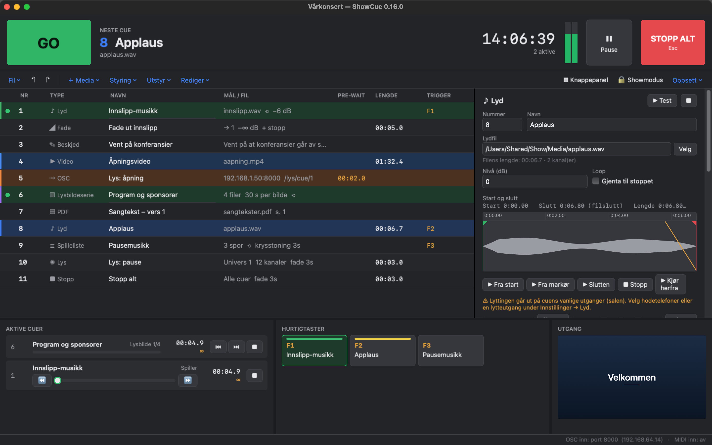
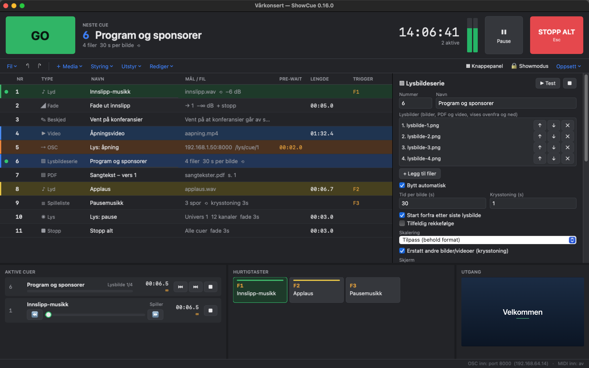
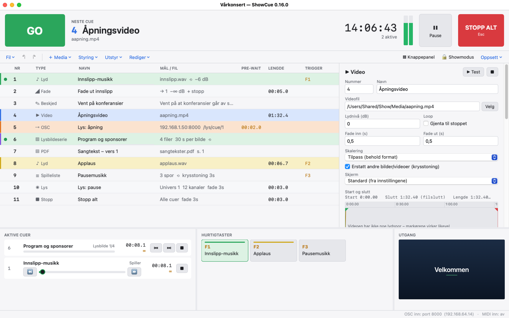
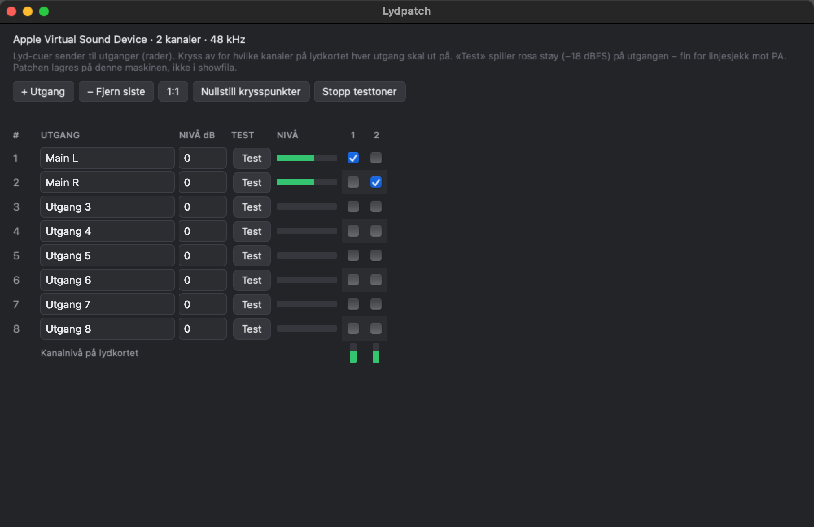
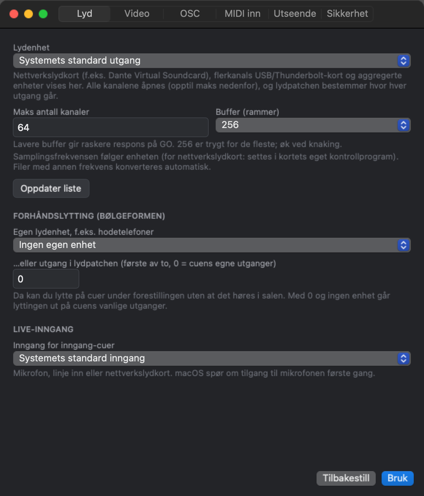

# ShowCue for Mac

*[English](README.md)*

Egen Mac-app skrevet i Swift. Den bruker Apples egne rammeverk (CoreAudio, AVFoundation, PDFKit og CoreMIDI) og trenger ingen tilleggsprogrammer.
Den har de samme funksjonene som Windows-versjonen, og **showfilene (`.showcue`) kan åpnes på begge plattformene**.

Krever macOS 13 (Ventura) eller nyere. Kjører både på Apple Silicon og Intel.

## Skjermbilder



| Lysbildeserie valgt | Lyst tema |
|---|---|
|  |  |

## Bygge og starte

**Enklest, med Xcode** (gratis fra App Store):
1. Dobbeltklikk `Package.swift`. Xcode åpner prosjektet.
2. Velg «My Mac» øverst og trykk ▶ (⌘R).

**Lage ShowCue.app** (Xcode eller Command Line Tools, `xcode-select --install`):
```
cd Mac
./build-app.sh
open build/ShowCue.app
```
Dra `build/ShowCue.app` til Programmer-mappa.

`./make-dmg.sh` lager i tillegg `build/ShowCue-Mac.dmg` (diskbilde med appen og en snarvei til Programmer).

**Ferdig app fra GitHub:** GitHub Actions bygger appen, kjører testene og legger `ShowCue-Mac.dmg` og `ShowCue-Mac.zip`
under *Releases*. Åpne dmg-fila og dra ShowCue til *Programmer*.

Appen er ikke notarisert av Apple ennå, så macOS stopper den første gang. Fra macOS 15 virker ikke lenger
«høyreklikk → Åpne»: åpne *Systeminnstillinger → Personvern og sikkerhet*, bla ned og trykk **Åpne likevel**.
Alternativt i Terminal: `xattr -dr com.apple.quarantine /Applications/ShowCue.app`.

Første gang du starter appen, spør macOS om tilgang til **lokalt nettverk**. Si ja, ellers virker ikke OSC.

## Hovedvinduet

- **Øverst:** en stor **GO**-knapp, **NESTE CUE** med nummer, navn og type i stor skrift (blå kant), klokke, nivåmålere, **Pause** og **STOPP ALT**.
- **Cuelista** har kolonneoverskrifter. Raden for cuen som **spilles nå** er grønn med fremdriftslinje og tid igjen i kolonnen *Gjenstår*
  («∞» for loop og cuer som står til stoppet). Cuen **GO starter** har blå kant og ▶. Deaktiverte cuer er dempet (og hoppes over av GO).
- **Panelet for valgt cue** er delt i faner: *Grunnleggende* (cuens egne felt), *Lyd/media* (nivå, fade, utganger, skalering og skjerm – bare for typer med lyd, bilde eller video),
  *Tidsstyring* (pre-wait, etterpå, tidskode-trigger, klokkeslett-trigger) og *Avansert* (hurtigtast, MIDI-trigger, knappepanel, farge, notater). Nummer og navn står alltid over fanene.
- **Nederst:** aktive cuer med fremdriftslinje og tid igjen, hurtigtaster og utgang.
- **Klokkeslett-trigger:** skriv et klokkeslett (tt:mm:ss, lokal tid, f.eks. 19:00:00) i fanen *Tidsstyring*, og slå på *Klokke-triggere aktive* under *Innstillinger → Sikkerhet* (av som standard).
  Cuen starter én gang når klokka på maskinen passerer klokkeslettet. Etter dvale, store hopp i klokka og omstilling til sommer-/vintertid starter ingen cuer. *Sjekk showet* advarer hvis innstillingen er av.
- **Showlogg:** *Fil → Showlogg* viser hva som skjer i denne kjøringen, fortløpende (cue startet med nummer, navn, type og hvordan den ble startet, ferdig eller stoppet, pause, stopp alt, GO-markør flyttet, feil og advarsler, show åpnet og lagret, programstart og avslutning).
  Bruk filteret for bare feil og advarsler, *Åpne eldre logg* for en tidligere kjøring, og *Eksporter CSV* / *Eksporter tekst* for å lagre det som vises (UTF-8; CSV bruker komma og har byte order mark så regneark leser æøå riktig).
  Én fil per kjøring skrives til mappa `Logs` ved siden av `Autolagring` og `Sikkerhetskopier` (`~/Library/Application Support/ShowCue/Logs`); de 30 nyeste beholdes, og en fil stopper ved 5 MB. Slå av under *Innstillinger → Sikkerhet → Skriv showlogg* (på som standard).
  Hver linje er ren tekst med tabulator mellom feltene: ISO-tid, tid siden start, hendelse, cuenummer, type, hvordan, navn og tekst (skråstrek, tabulator og linjeskift i tekster skrives som `\\`, `\t` og `\n`).
- **Øvelsesmodus** (*⌘R*, eller *Oppsett → Øvelsesmodus* / knappen *Øvelse*): hopp over valgte cuer under øvelser uten å slette eller deaktivere dem.
  Kryss av for *Hopp over i øvelse* i fanen *Tidsstyring* (en liten *ØV*-merking vises i cuelista). Mens modusen er på, flytter GO, auto-fortsett og auto-følg seg forbi merkede cuer og starter dem aldri,
  og klokkeslett- og tidskode-triggere starter dem heller ikke. Å starte en merket cue direkte virker fortsatt: med nummer (OSC, MIDI show control), hurtigtast, MIDI-trigger, knappepanel, dobbeltklikk og som mål i en gruppe-cue.
  Et tydelig felt øverst i vinduet står der så lenge modusen er på, og vindustittelen viser det også. Modusen **lagres aldri**: programmet starter alltid med den av. *Sjekk showet* advarer mens den er på og teller de merkede cuene.
- **Forhåndslast neste cue:** *Innstillinger → Sikkerhet → Forhåndslast neste cue* (av som standard, prøv først på eget utstyr) forbereder cuen under GO-markøren og cuene den starter automatisk (høyst tre filer) i bakgrunnen, så lyd og video starter med mindre forsinkelse. Feiler forberedelsen, starter cuen som vanlig.

## Flerkanals lydkort og nettverkslyd

DVS på Mac er en vanlig CoreAudio-enhet:
Eksempel med Dante Virtual Soundcard:

1. Start Dante Virtual Soundcard. Velg antall kanaler i DVS og samplingsfrekvens i Dante Controller.
2. ShowCue → **Innstillinger → Lyd**: velg «Dante Virtual Soundcard». Alle kanalene åpnes, opptil 64 som standard.
3. **Lydpatch** (*Oppsett → Lydpatch*): kryss av hvilke Dante-kanaler hver utgang skal på. Du kan linjesjekke med **Test** (rosa støy på −18 dBFS).
   Rut kanalene videre i Dante Controller.

Det samme gjelder andre flerkanals lydkort og aggregerte enheter laget i Lyd- og MIDI-oppsett.
Samplingsfrekvensen følger enheten, og filer med en annen frekvens konverteres automatisk av høy kvalitet.

| Lydpatch | Innstillinger |
|---|---|
|  |  |

## Forskjeller fra Windows-versjonen

| | Mac | Windows |
|---|---|---|
| Lyddriver | CoreAudio (alle enheter, også nettverkslydkort) | WASAPI eller ASIO |
| Lydformater | WAV, AIFF, MP3, M4A/AAC, ALAC, FLAC, CAF | WAV, AIFF, MP3, M4A/AAC, FLAC, WMA |
| Videoformater | MP4, MOV, M4V (H.264, HEVC, ProRes) | MP4, MOV, WMV, AVI, MKV (H.264 tryggest) |
| Innstillinger | `~/Library/Application Support/ShowCue/` | `%AppData%\ShowCue\` |
| Zoom i bølgeform | Knip på styreflaten eller −/+ | Musehjul |
| Hurtigtaster | F-tastene krever `fn`, med mindre «Bruk F1, F2 osv. som standard funksjonstaster» er slått på | |

Routingforhåndsvalg fungerer som på Windows: knappen *Forhåndsvalg* under routingmatrisen setter et navngitt forhåndsvalg (utgangspar som `1-2` eller `3-4:-6`, lagret i showet) på cuen og alle andre valgte cuer, og kopierer/limer inn routing mellom cuer.

Alt annet er likt: språk (norsk/engelsk), cuetyper, start/slutt-redigering med bølgeform og forhåndslytting, routingmatrise, lydpatch, videolyd gjennom patchen, OSC/MIDI inn og ut, MSC, status ut over OSC, temaer og cuefarger.
Se README i Windows-mappa for full beskrivelse av OSC-kommandoer og statusvariabler.

**Nettside for mobil/nettbrett** (*Innstillinger → Web*, av som standard, krever PIN-kode): se «Nettside for mobil og nettbrett» i Windows-README. På Mac kan macOS spørre om tilgang til lokalt nettverk første gang. Trafikken er vanlig HTTP, så PIN-koden beskytter bare mot tilfeldig bruk på et nettverk du stoler på.

**Showfiler mellom Mac og Windows:** stiene til mediefilene er forskjellige på de to plattformene. ShowCue leter derfor etter mediefiler
ved siden av showfila og i en undermappe `Media`, så legg showfil og media i samme mappe når du flytter mellom maskiner.
Show lagret på Mac krever Windows-versjon 0.4 eller nyere.

## Tastatur

| Tast | Funksjon |
|---|---|
| Mellomrom | GO |
| Esc | Stopp alt (to ganger = umiddelbart) |
| ↑ / ↓ | Flytt GO-markøren |
| ⌥⌘← / ⌥⌘→ | Forrige / neste scene (menyen *Scene* og velgeren over cuelista styrer scenene) |
| ⌘1 … ⌘8 | Legg til lyd, video, bilde, PDF, fade, stopp, OSC, MIDI |
| ⌘9, ⌘0 | Legg til spilleliste, gå til-cue |
| ⌘P | Pause / fortsett alt |
| ⇧⌘M, ⇧⌘N | Legg til beskjed-, nettverks-cue |
| ⌘K | Knappepanel |
| ⌘+ / ⌘− | Zoom inn / ut (vanlig størrelse i *Oppsett*-menyen) |
| ⌥⌘T, ⇧⌘L, ⇧⌘I, ⇧⌘W | Legg til tidskode-, lys-, inngang-, nettside-cue |
| ⇧⌘B | Legg til lysbildeserie |
| ⌘D, ⌘⌫, ⌘↑/⌘↓ | Dupliser, slett, flytt |
| ⌘S, ⇧⌘S, ⌘O, ⌘N | Lagre, lagre som, åpne, nytt |
| ⌘Z, ⇧⌘Z | Angre, gjør om |
| ⌘L | Showmodus (lås redigering) av/på |
| ⌘R | Øvelsesmodus av/på |
| ⇧⌘T | Bytt tema |
| ⇧⌘U | Vis/skjul utgangsvinduet |
| ⌘, | Innstillinger |

Lyd- og video-cuer som spiller kan spoles under *Aktive cuer* (dra i linja, eller ⏪ / ⏩ for 5 sekunder).
*＋ Media* lager en tom cue; velg fila med *Bla*, eller slipp en fil på cuen.

Klikk velger, ⌘-klikk velger flere og ⇧-klikk velger et område. Dobbeltklikk tester cuen. Høyreklikk åpner en meny med farge, aktiver/deaktiver og dupliser.
Du kan dra filer fra Finder rett inn i lista.

Showmodus, angre, autolagring (`~/Library/Application Support/ShowCue/Autolagring`), sikkerhetskopier
(`…/ShowCue/Sikkerhetskopier`) og forhåndslytting til hodetelefoner virker som på Windows – se *Trygt under forestillingen*
i README i Windows-mappa. Det samme gjelder pause, spillelister, gå til, slipp loop, kjør herfra og fadekurver
(*Pause, spillelister og loop*), og knappepanelet, nettverks- og beskjed-cuer, lydstyrke-normalisering og finn/samle
mediefiler (menyene *Fil*, *Rediger* og *Verktøy* i menylinja) – se *Knappepanel, nettverk, beskjed og lydstyrke* og *Mediefiler: finn og samle*. *Sjekk showet* (under *Fil* og *Verktøy*) kontrollerer mediefiler, verdier, enheter og cue-numre før forestillingen – se *Sjekk showet før forestillingen*. Tidskode, lys over Art-Net og
live-inngang er beskrevet under *Tidskode, lys og live-inngang* (på Mac velges inngangen blant CoreAudio-enhetene,
og macOS spør om tilgang til mikrofonen første gang).

## Oppbygning

```
Sources/ShowCue/
  Core/    Modeller (samme JSON som Windows), OSC, status ut, fjernstyring, språk (Loc),
           MIDI-tolking, mikser (PatchMixer, Voice, ringbuffer). Testes automatisk.
  Audio/   CoreAudio-utgang (AUHAL), enheter, dekoding i egen tråd (AVAudioFile / AVAssetReader)
  Engine/  Cue-motor, aktive cuer, video/bilde/PDF-utgang, CoreMIDI, app-modell
  UI/      SwiftUI: hovedvindu, cueliste, inspektør, routingmatrise, lydpatch, innstillinger, temaer
Tests/     XCTest (kjøres med «swift test» eller ⌘U i Xcode)
```

Lydtråden leser bare ferdig dekodet lyd fra ringbuffere. En egen tråd dekoder, og hovedtråden styrer cuene.
Lyden venter derfor aldri på disk eller brukergrensesnitt.
