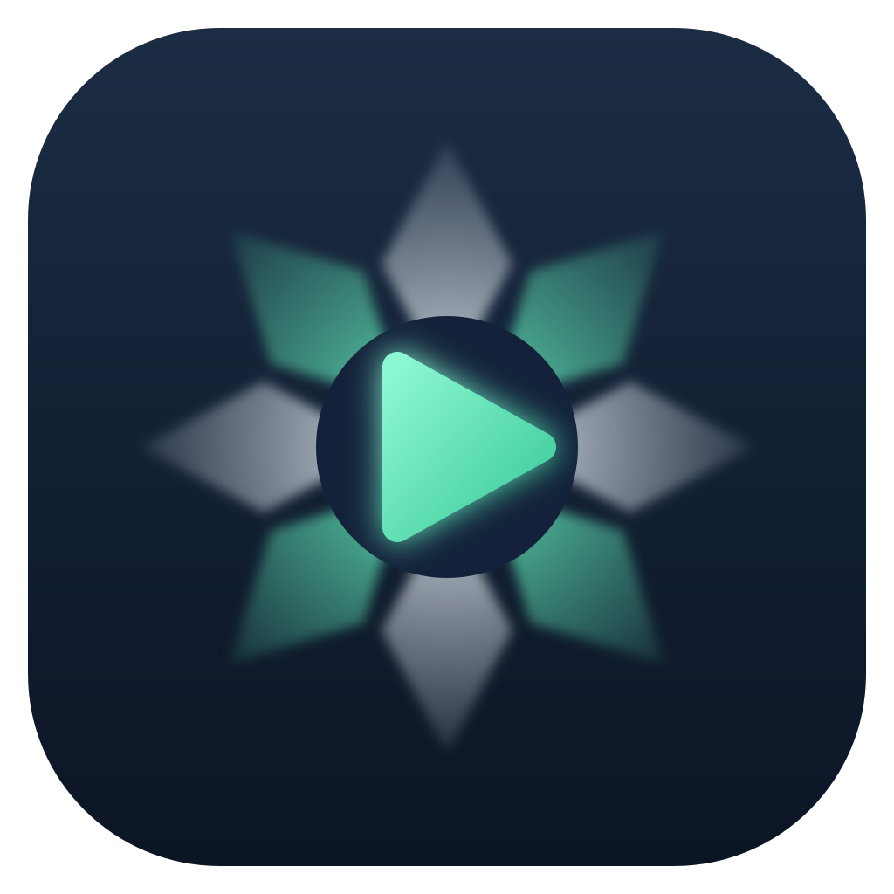

# ShowCue

If you like this app and want to support me:

*[English](README.en.md)*

Showavvikling for Windows og Mac.

Cue-basert avspillingsprogram for konsert, event og teater.
Det finnes i to utgaver som deler showformat:

| Mappe | Plattform | Teknologi | Bygging |
|---|---|---|---|
| `Windows/` | Windows 10/11 | C# / .NET 10 / WPF / NAudio | `build.bat`, eller Visual Studio |
| `Mac/` | macOS 13+ | Swift / SwiftUI / CoreAudio / AVFoundation | Åpne `Package.swift` i Xcode, eller `./build-app.sh` |

Begge har:
- Cuer for lyd, video, bilde, PDF, nettside, fade, stopp, OSC, MIDI, spilleliste, lysbildeserie, «gå til», beskjed og nettverk (UDP/TCP/HTTP)
- **Tidskode** (MTC/LTC ut, MTC-triggere inn), **lys over Art-Net** og **live-inngang** gjennom lydpatchen
- **Knappepanel** med store knapper (jingler, effekter, berøringsskjerm), **lydstyrke-normalisering** (LUFS) og **finn/samle mediefiler**
- **Lysbildeserie** som bytter mellom bilder, PDF-sider og videoer automatisk (eller manuelt), med krysstoning og loop
- **Pause/fortsett alt**, **spoling i sanntid** i lyd og video som spiller, slipp loop (devamp), start fra markøren og fadekurver
- **Start og slutt med bølgeform**, zoom og forhåndslytting gjennom lydpatchen
- Pre-wait, auto-continue og auto-follow
- Hurtigtaster og MIDI-triggere per cue
- **Lydpatch** for flerkanals lydkort og nettverkslyd (f.eks. Dante), med routingmatrise per cue, testtone og nivåmålere
- **Lyd i video** som går gjennom lydpatchen og holdes i synk med bildet, og **valgfri skjerm per cue**
- **Fjernstyring** med OSC inn, MIDI inn og MSC
- **Status ut over OSC** (f.eks. til Companion): neste cue, hva som spiller og tid igjen
- **Mørkt, grått, lyst og nattmodus**, **zoom** og større tekst i cuelista, og fargemerking av cuer
- **Norsk og engelsk** brukerflate (velges under *Innstillinger → Utseende*)

Showfiler (`.showcue`) kan flyttes fritt mellom Mac og Windows. Legg mediefilene i samme mappe som showet,
eller i en undermappe `Media`.

## Last ned

Ferdige programmer ligger under **Releases** på GitHub:
- **ShowCue x.y.z** – utgitte versjoner, med endringene i utgivelsesteksten.
- **Siste bygg** – bygges automatisk ved hver endring på main, for å teste det nyeste.

| | Installasjon | Uten installering |
|---|---|---|
| **Windows** | `ShowCue-Setup.exe` – snarvei i Start-menyen, valgfritt skrivebordsikon, `.showcue`-filer åpnes med ShowCue, avinstalleres fra Innstillinger → Apper | `ShowCue.exe` – én fil som kan kopieres rett til show-PC-en |
| **Mac** | `ShowCue-Mac.dmg` – åpne og dra ShowCue til *Programmer* | `ShowCue-Mac.zip` |

Programmene er ikke kodesignert ennå:
- **Windows** viser «Windows beskyttet PCen din» første gang. Trykk *Mer informasjon* → *Kjør likevel*.
- **Mac** stopper appen første gang. Åpne *Systeminnstillinger → Personvern og sikkerhet*, bla ned og trykk *Åpne likevel*.

## Versjoner og endringslogg

Versjonsnummeret står i `VERSION` og brukes av både Windows- og Mac-bygget. Endringer føres i `CHANGELOG.md`.

Slik bygges og gis programmet ut (`.github/workflows/build.yml`):
1. Endringer gjøres på en egen gren og sendes inn som en *pull request*. GitHub bygger og tester både Windows- og Mac-versjonen.
2. Når begge er grønne, flettes endringen inn i `main` (som er beskyttet: den tar bare imot endringer som har bestått byggene).
3. På `main` bygges og testes alt på nytt. Først når begge plattformene er ferdige, publiseres nøyaktig de samme filene:
   til «Siste bygg» hver gang, og til en ny utgivelse `v<versjon>` når `VERSION` er økt.
4. Hver fil får en SHA-256-sjekksum og en opprinnelsesattest fra GitHub. Kontroller en nedlastet fil med
   `gh attestation verify ShowCue-Setup.exe -R trondmorset-lab/Showcue-`.

GitHub Actions-trinnene er låst til faste versjoner (commit-SHA), og Dependabot foreslår oppdateringer hver uke.

Se `Windows/README.md` og `Mac/README.md` for detaljer.

## Lisens

Copyright © 2026 Trond Morset.

ShowCue er fri programvare: du kan distribuere og endre den under vilkårene i GNU General Public License,
versjon 3 (GPL-3.0), slik den er utgitt av Free Software Foundation. Se `LICENSE` for hele teksten.
Programmet leveres uten noen form for garanti.

Komponenter fra andre og lisensene deres står i `THIRD-PARTY-NOTICES.txt`: [NAudio](https://github.com/naudio/NAudio),
.NET-kjøretiden (MIT) og Microsoft WebView2 SDK (BSD) i Windows-versjonen, og merknaden for Art-Net™. Fila følger med i
installasjonsprogrammet, i Mac-appen og i hver utgivelse, og vises under *Om ShowCue* i programmet.
Lyd- og videokodeker leveres av operativsystemet; ShowCue har ingen egne.
